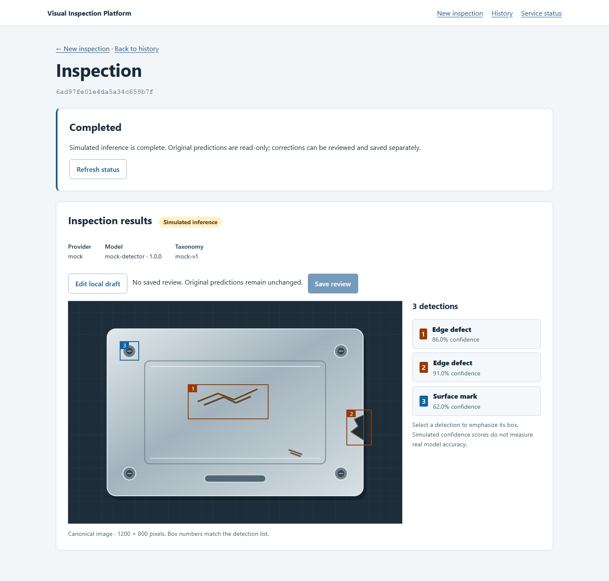
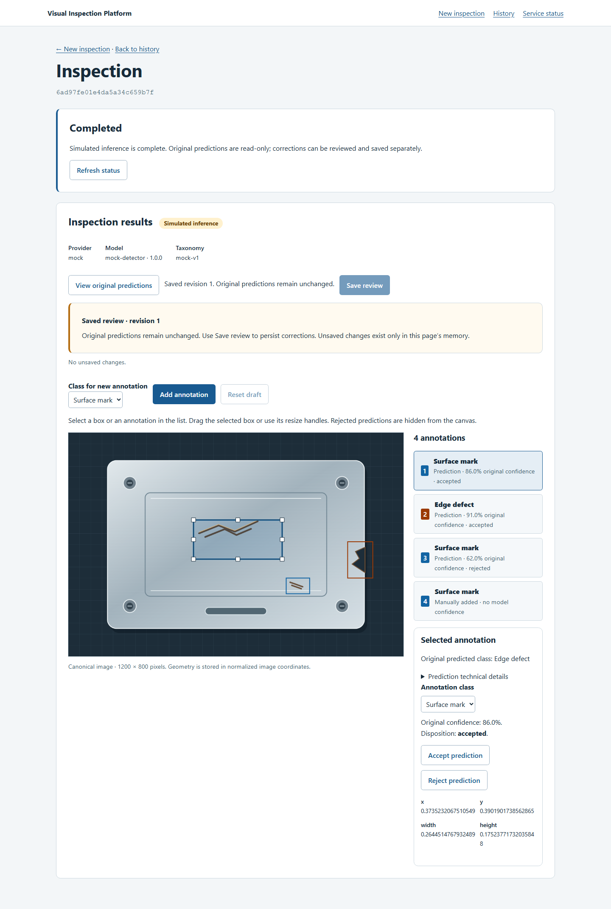
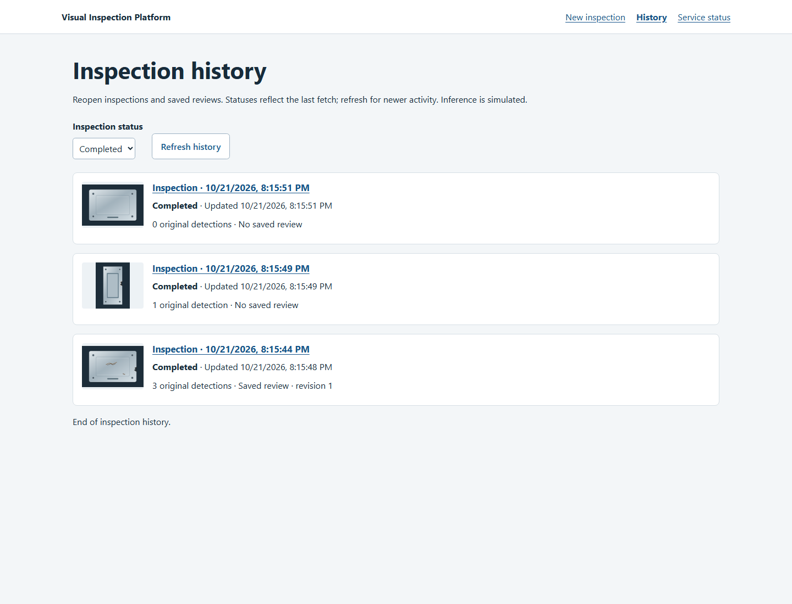
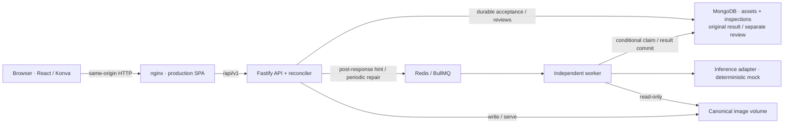

# Visual Inspection Platform

[](https://github.com/ThePhysic/visual-inspection-platform/actions/workflows/ci.yml)

**Upload an image, inspect simulated detections, correct annotations, and reopen a saved human review.**

A full-stack portfolio application demonstrating the engineering behind an image
inspection workflow: reliable asynchronous execution, interactive geometry,
persistent corrections, and recovery when requests or workers fail.

**Inference is deterministic and simulated.** This project does not train a model,
recognize real manufacturing defects, or measure computer-vision accuracy.

## See the workflow



The panel is an original synthetic illustration. Its hand-authored mock output
includes an intentionally wrong class, a false positive, and a missed mark so the
review workflow has something meaningful to correct.

<details>
<summary>Saved corrections and inspection history</summary>





</details>

**Recording: not recorded yet.** Follow the [2–3 minute demo script](docs/demo.md)
to reproduce upload → inspect → edit → save → refresh → history. Screenshots come
from the real browser/API/worker stack; [capture provenance and regeneration](docs/screenshots/README.md)
are included. There is no hosted public demo.

## Engineering capabilities

- **Interactive React/TypeScript editor:** select, drag, resize, relabel, reject,
  restore, and draw annotations with react-konva; responsive canonical-image geometry.
- **Fastify REST API and shared TypeBox contracts:** runtime request/response
  validation, strict TypeScript, canonical JPEG/PNG ingestion with Sharp.
- **MongoDB persistence:** immutable original predictions and a separate current
  human-review snapshot with revisions, optimistic concurrency, and bounded save receipts.
- **Redis/BullMQ processing:** independent worker, durable MongoDB acceptance,
  prompt dispatch, periodic reconciliation, execution ownership, and bounded retries.
- **Recovery UX:** stable inspection URLs, network retry identity, explicit review
  conflicts, cursor-paginated history, and linked manual retry attempts.
- **Reproducible operations:** five-service Docker Compose, non-root application
  processes, shared persistent images, structured correlation logs, and local metrics.
- **Verification:** Vitest, React Testing Library, real MongoDB/Redis integration
  tests, Playwright canvas interactions, and disposable-container interruption tests.

## Architecture



MongoDB is the source of truth. A `202` confirms persistence before best-effort
dispatch; Redis unavailability does not invalidate accepted work. Generation-specific
jobs, attempt tokens and conditional writes arbitrate at-least-once execution.
Review saves never replace model predictions. See the [architecture guide](docs/architecture.md),
[pipeline guarantees](docs/inspection-pipeline.md), and [review contracts](docs/reviews.md).

## Measured engineering results

Prompt dispatch removed the normal wait for a five-second recovery scan.
**Median result visibility fell from 4,955 ms to 113 ms (97.7%)** in a matched
sequential workload. It did not accelerate a real ML model.
These are the preserved Task 05C-OPT measurements, not a new benchmark of the
larger release-demo illustrations.

| Measurement | Before | After |
| --- | ---: | ---: |
| API acceptance p50 / p95 | 12.370 / 13.859 ms | 10.279 / 14.656 ms |
| Creation to worker claim p50 / p95 | 4916 / 4972 ms | 10 / 12 ms |
| Worker attempt p50 | 7.340 ms | 6.639 ms |
| Simulated provider invocation p50 | 0.077 ms | 0.068 ms |
| Result visibility after acceptance p50 / p95 | 4955.314 / 5046.764 ms | 113.262 / 115.845 ms |
| Closed-loop completed inspections/sec | 0.200 | 8.054 |

Conditions: **eight measured samples before and after**, one concurrency-one worker,
one API, a **64×64 / 189-byte deterministic PNG**, Windows/Docker Desktop on a Ryzen
9 7940HS, and **100 ms benchmark polling**. These tiny benchmark fixtures differ
from the larger portfolio illustrations. Creation-to-claim includes insertion;
it is not an exact response-acknowledgement interval. Visibility includes polling.

At four outstanding inspections, matched visibility p50 fell from 4,963 to 120 ms,
while acceptance p50 increased from 13.9 to 23.4 ms. An additional **24 samples per
scenario** measured visibility p50/p95 of **112/116 ms sequentially** and
**117/122 ms concurrently**. All 80 post-optimization measured inspections completed
without errors/timeouts. History medians were modestly higher; no history speedup
is claimed. These are exploratory closed-loop observations, not capacity, real-model
performance, cloud estimates, or service-level promises.

Read the [methodology, full environment, tradeoffs and before/after tables](docs/performance.md)
and [original measured JSON reports](docs/performance-results/).

## Quick start — Docker only

Prerequisites: Git and Docker Desktop using Linux containers, or Docker Engine
with Compose **2.20+** and BuildKit. Registry access is needed for initial builds.
**No host Node.js, pnpm, credentials, or `.env` file is required.**

```powershell
git clone https://github.com/ThePhysic/visual-inspection-platform.git
cd visual-inspection-platform
docker compose -p vip-demo up -d --build --wait --wait-timeout 120
```

Open **http://127.0.0.1:8080**. Upload
[`fixtures/inspections/machined-panel.png`](fixtures/inspections/machined-panel.png),
choose **Upload and inspect**, then **Edit local draft** and **Save review**.
Use `clean-panel.png` for zero detections and `edge-component.png` for portrait
geometry. [Fixture provenance and expected regions](fixtures/inspections/README.md).

```powershell
docker compose -p vip-demo ps
docker compose -p vip-demo logs --tail 100 api worker
curl.exe http://127.0.0.1:8080/api/v1/ready
docker compose -p vip-demo down
```

On Bash use `curl` instead of `curl.exe`. Start again with the same `up` command
and project name to reuse records, reviews, Redis persistence, and images.
**Do not use `down -v` for routine shutdown: it deletes stored data.**

Only the web port is published, on loopback. To avoid a port conflict, set
`WEB_PORT` in an optional root `.env`, or `$env:WEB_PORT = '18080'` in PowerShell.
For missing-engine errors, start Docker Desktop/check the Linux context. For
unhealthy services, inspect logs rather than deleting volumes. See
[container setup, rebuilds and troubleshooting](docs/containers.md) and
[MongoDB/kernel compatibility](docs/ci-mongodb-compatibility.md).

## Native development

Use pinned **Node 24.22.0** and **pnpm 10.34.7**; Docker runs only the dependencies:

```powershell
pnpm install --frozen-lockfile
docker compose -p vip-native -f compose.yaml -f compose.dev.yaml up -d --wait mongodb redis
pnpm dev
```

Open **http://127.0.0.1:5173**. This starts web, API and worker on the host.
MongoDB/Redis host ports are loopback-only. Native images live in `.data/images`;
native and full-container stores are separate. Defaults work without `.env`;
see [.env.example](.env.example) and the [development/configuration guide](docs/development.md).

## Tests and reproducible verification

```powershell
pnpm lint
pnpm typecheck
pnpm test
pnpm build
pnpm --filter @vip/web exec playwright install chromium
# Owned disposable dependencies: runs real integration tests and native E2E.
pnpm test:ci:integration
# Owned full stack: smoke, browser, outages, restarts, storage, down/up persistence.
pnpm test:reliability --browser
```

With dedicated MongoDB/Redis already available, `pnpm test:integration` and
`pnpm test:e2e` remain available separately. On Linux, Playwright may require
`playwright install --with-deps chromium`. Direct tests require isolated test
configuration; avoid personal demo data. Missing dependencies fail tests.

CI runs lint/typecheck/unit/build on Ubuntu and Windows, real MongoDB/Redis plus
Chromium integration flows, full-container browser/recovery checks, and a bounded
benchmark-harness smoke. No performance timing threshold gates CI, and CI does
not publish or deploy. [Final QA evidence and coverage boundaries](docs/release-readiness.md).

`pnpm portfolio:capture` regenerates authentic screenshots in an owned disposable
stack. `pnpm benchmark` runs an isolated benchmark; both require native tooling.
See [demo/recording instructions](docs/demo.md), [operations and metrics](docs/observability.md),
and [reliability evidence](docs/reliability.md).

## Limitations and next steps

- Simulated outputs and scores are not defect recognition, model accuracy, or real inference latency.
- Trusted local/demo use only: no authentication, authorization, public TLS, or internet hardening.
- Single-host image storage; no coordinated backups, disaster-recovery or high-availability guarantee.
- At-least-once attempts can repeat inference. No exactly-once execution promise.
- Reviews retain the latest snapshot and bounded operation receipts, not an immutable audit history.
- Unsaved drafts exist in memory. Browser/mobile navigation warnings are best effort.
- Future real inference can implement the provider boundary; camera ingestion, S3/cloud and
  orchestration remain optional work, not implemented capabilities.

No repository license has been selected. No license or redistribution grant is
implied for the whole project; see [portfolio/repository presentation notes](docs/portfolio-summary.md).
This is release preparation, not a published or tagged release.
