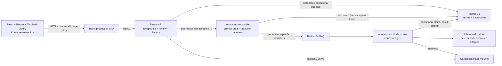

# Implemented architecture

This is a single-host, trusted local/demo application. The inference adapter is a
deterministic simulator, not a trained detector. The diagram contains only current
components; cloud, external inference, camera and orchestration services are absent.

nginx serves the production React build with SPA deep-link fallback, proxies
same-origin `/api/` requests to `api:3001`, and publishes only loopback port 8080
by default. Compose runs web, API, worker, MongoDB and Redis on an internal
network. API/worker share one image volume; MongoDB and Redis have separate named
volumes. The worker mounts images read-only. Ordinary restarts and `down` preserve
volumes. See [image packaging, permissions and topology](containers.md).

## Ownership and package boundaries

| Boundary | Responsibility |
| --- | --- |
| `apps/web` | Upload/submission, polling, history, draft editing and explicit save/conflict UX |
| `apps/api` | Fastify construction/routes, request schemas, admission readiness and process startup |
| `apps/worker` | Independent consumer startup/shutdown, structured logs, expiring local health observation |
| `packages/contracts` | Browser-safe TypeBox wire schemas and semantic box/review validators |
| `packages/backend` | Mongoose models, canonical storage boundary, acceptance, dispatch/recovery and execution |

The worker does not import the API entry point. `buildApp` can be exercised by
Fastify injection without opening a listener or connecting as an import side
effect. Runtime startup initializes MongoDB/indexes before listening. The frontend
validates responses against shared contracts instead of redefining backend DTOs.

## Data and canonical geometry

There are two collections:

- **Assets:** server-generated storage key, canonical MIME/dimensions/byte count,
  SHA-256, source and creation time. Identical content may be uploaded twice.
- **Inspections:** asset reference, requested configuration, lifecycle, immutable
  committed `result`, independent optional `review`, and bounded ownership,
  dispatch, retry and review-operation metadata. Reviews are not a third collection.

The result holds original prediction identity, class, confidence, normalized box
and provider/model/taxonomy metadata. The current review contains a complete
annotation snapshot, revision and save timestamp. Each original prediction keeps
one accepted/rejected disposition; manual annotations have no model confidence.
The latest snapshot replaces the previous one. This is not immutable audit history.

Upload streams to private staging, validates actual JPEG/PNG contents, enforces
10 MiB input / 20 megapixels, rejects multi-frame images, auto-orients EXIF
including mirrors, strips metadata and encodes canonical sRGB bytes with Sharp.
Exclusive hard-link publication precedes MongoDB asset insertion. MongoDB and the
filesystem are not a transaction; uncertain inserts can leave retained orphan
files. Offline staging cleanup is conservative; published orphan deletion is
report-only. [API/storage details](api.md), [maintenance safeguards](reliability.md).

All boxes use top-left normalized `{x,y,width,height}` against the **stored,
auto-oriented image**, not original camera pixels or viewport pixels. Finite
cross-field bounds are enforced. The editor converts to the image's displayed
rectangle, handles Konva scale and responsive resizing, then stores normalized
geometry in a separate immutable-updated draft. [Editor geometry](annotation-editor.md).

## Acceptance, dispatch and at-least-once execution

1. Creation validates the asset and durably inserts queued inspection intent.
   Persistent `(requestScope, requestKey)` uniqueness resolves duplicate races;
   semantic request fingerprints distinguish replay from conflicting key reuse.
2. The API sends **202 before** the best-effort post-response notification. A
   bounded, coalesced ID set wakes the existing reconciler; prompt and periodic
   work share one serial drain and dispatch routine. There is no second dispatcher.
3. Startup and five-second bounded scans repair missed dispatch and expired
   ownership. Overflow, shutdown or Redis failure can leave work for those scans.
4. BullMQ messages contain only payload version, inspection ID and dispatch
   generation. The worker atomically claims due queued work, increments the
   persistent attempt count and obtains a token with a fixed execution lease.
5. It reads canonical bytes, invokes the provider, validates the unknown output,
   and conditionally commits the result and completed state using status,
   generation, token, unexpired lease and absence of an earlier result.

Retryable errors use bounded backoff; terminal errors produce safe failure
information. Redis delivery retries cannot reset the stored three-attempt budget.
A stale/duplicate worker cannot replace an authoritative result. Actual inference
may repeat after interruption: **at-least-once attempts, not exactly-once execution**.
Manual retry creates a new linked inspection and preserves its failed predecessor.
[Failure windows, deadlines and recovery assumptions](inspection-pipeline.md).

## Review saves and conflicts

The editor initializes from a saved review when present, otherwise copied original
predictions. A keyed workspace keeps baseline/draft/selection separate and avoids
resetting dirty edits on refetch. Every save submits a complete validated snapshot,
expected revision/write sequence and stable operation UUID.

One MongoDB conditional update matches both expected tokens. Concurrent different
saves cannot both win; stale edits receive 409 and remain in the browser until
the user deliberately loads the newer review. Ambiguous network retries reuse
the exact operation and payload. The last 32 durable receipts detect duplicates
within a bounded window; an evicted operation can conflict rather than being
silently replayed. Changed snapshots advance the review revision; semantic no-ops
do not. Original inference fields are never in the allowlisted review update.
[Review API and bounded-idempotency details](reviews.md).

## History and operations

History projects bounded summaries instead of full results/reviews. Ordering is
`createdAt desc, _id desc`; opaque cursors carry the boundary and status context.
Compound indexes support both all/status-filtered queries. Pages are live rather
than snapshot-isolated. [History API and indexes](history.md).

Liveness differs from admission readiness and worker progress. API readiness
requires MongoDB/storage, reporting Redis separately so durable acceptance can
continue during dispatch outages. The worker's expiring local health file tracks
connections and bounded active work. Per-process metrics use separate loopback
operator listeners, not public nginx endpoints. Correlation IDs belong in logs,
not metric labels. [Operations](observability.md), [tested guarantees/limits](reliability.md).

The small provider interface is the real-ML integration seam. No Python service,
model training, camera pipeline, S3 or cloud deployment is implemented or required.
