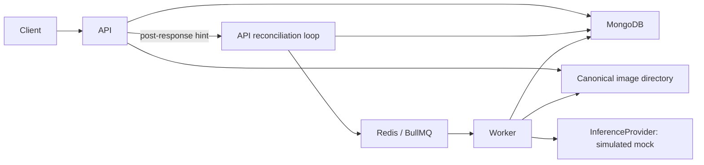

# Inspection execution and recovery

## Boundaries and authority

MongoDB owns accepted inspection state. Redis/BullMQ schedules execution. The API
never gates a successful acceptance on a Redis response. After sending the 202,
it notifies its existing reconciler to try dispatch promptly. There is one
`assets` collection and one `inspections` collection;
no separate outbox or reconciliation service is used.

`packages/contracts` contains browser-safe TypeBox schemas and semantic inference
validation. `packages/backend` contains shared models, storage, execution,
reconciliation, and the provider interface. The existing API persistence/storage
modules re-export shared code to preserve their import boundary; logic is not
duplicated. `apps/worker` imports backend code, never the API entry point.

## Durable acceptance and identity

Inspections store an asset reference, immutable requested configuration, scope,
key, fingerprint, original request ID, timestamps, status, attempt count/budget,
next-attempt time, dispatch generation, and optional execution token/lease.
Completed results are embedded. The latest human review is embedded separately
under `review`; bounded save receipts live under `reviewControl`. These fields are
written only by the review API, never by the provider or worker. See
[review snapshots](reviews.md) for revision checking and save retry semantics.

A SHA-256 fingerprint covers a fixed-order representation of normalized asset ID
and effective provider configuration for creation. Retry fingerprints cover the
normalized parent inspection ID; that parent's configuration is immutable.
Operations have separate, explicit global scopes. A unique partial compound index
on `(requestScope,requestKey)` resolves concurrent insert races. Replays compare
the stored fingerprint. They do not create another inspection. A replay that is
still queued may hint dispatch again; generation-specific job IDs and conditional
claims arbitrate concurrent producers and deliveries.

Additional indexes are `(createdAt desc,_id desc)` and `(status,updatedAt)`.
History also uses `(status,createdAt desc,_id desc)`, and forward retry navigation
uses `(retriedFrom,createdAt desc,_id desc)`. See [history](history.md) for query and
live-pagination semantics. Manual retry continues to create a separate linked
record and never updates its failed predecessor.
Idempotency keys persist with records; there is no retention/deletion API yet.

## Attempt ownership

The worker atomically claims only a due, queued inspection whose generation
matches the queue payload and whose attempt count is below its stored budget.
The same update increments the persistent count, generates an attempt token, and
sets processing status, start time, and a fixed lease. Asset reading/checksum
verification and inference take place after this claim and consume the attempt.

The provider accepts canonical bytes, MIME type, dimensions, checksum, and a
cancellation signal. It returns an unknown value that the worker validates against
the versioned contract and semantic constraints. The interface gives the provider
no database, queue, or review capability. Test providers supply controlled errors,
unresponsive promises, and explicit gates; production has no fault-injection API
or environment switches.

Result validation covers finite values, confidence bounds, positive dimensions,
`x+width <= 1`, `y+height <= 1`, unique prediction IDs, at most 200 detections, and
matching provider/model/taxonomy metadata. A validated result is copied before
persistence. The atomic completion update matches processing status, generation,
token, an unexpired lease, and absence of an earlier result. It writes the complete
result and completed state together. Failure updates use the same ownership guard.

There is no result-editing endpoint. Original predictions remain unchanged after
successful completion through application APIs and execution paths. Privileged
direct database modifications are outside this guarantee.

## Prompt dispatch, retries and repair

MongoDB status `queued`, generation, and next-attempt time form durable dispatch
intent. Queue payloads contain only version, inspection ID, and generation. A
queue job ID is deterministic for that generation; it supplements persistent
idempotency rather than replacing it.

Both creation and manual retry mark a queued acceptance for a Fastify
`onResponse` notification. **The 202 is sent before scheduling begins**; it means
durable MongoDB acceptance, not confirmed Redis scheduling. The reconciler
coalesces identifiers in memory, schedules one event-loop callback, fetches the
current queued records by ID, and uses the same per-record dispatch routine as
repair. It never dispatches before acceptance succeeds. Terminal/processing
replays do not request prompt dispatch; the targeted read also excludes them.

There is one serial drain per API process for prompts and recovery scans.
Pending hints are capped at `batchSize` (50), plus at most one active batch of
50. Duplicate pending/active IDs coalesce; excess hints are dropped safely because
MongoDB remains the durable work list. Notifications arriving during a pass
are handled afterward, without waiting for the periodic timer. A scan requested
during a prompt batch is not lost. Scans retain priority between prompt batches.
Scan-dispatched IDs consume corresponding pending hints to avoid an extra check.

Redis failures/timeouts are caught and logged with `dispatchSource`; no detached
per-request promises or independent dispatcher are created. Existing producer
settings bound Redis commands (1.5 seconds), disable offline queuing, and retain
bounded request retries; HTTP never waits for these operations. This is not a
new universal wall-clock deadline for every library/database call. Shutdown
cancels the scheduled callback, drops unstarted hints and waits for in-flight
dispatch; subsequent startup/periodic repair recovers the retained intent.
An API crash before its response hook, a full hint set, failed targeted lookup,
or failed scheduling can therefore retain the old scan-based latency. No lease,
attempt deadline, backoff, generation, result or review semantics change.

A full recovery scan on every request would needlessly repeat lease/queue scans;
a second dispatcher would duplicate correctness logic. A targeted, bounded hint
inside the existing reconciler avoids both. Waiting for Redis before replying
would unnecessarily add queue availability to acceptance latency.

Retryable provider/I/O/database failures return owned processing records to
queued with exponential backoff, then fail the BullMQ delivery so its native retry
can execute. Invalid persisted data, invalid output, and permanent provider errors
are terminal. At the final permitted application attempt, retryable failures also
become terminal. Every new claim checks the stored budget, regardless of how often
a queue job is recreated.

The API starts reconciliation after listening and runs it every five seconds,
with no overlapping passes. Each pass processes at most 50 expired leases and 50
queued documents. Checked queued documents move to the back of the scan through
`updatedAt`, including healthy waiting/delayed jobs, so they cannot indefinitely
starve later records. Consequently `updatedAt` includes dispatch checks, not only
user-visible state transitions.

Expired processing is conditionally failed when its budget is exhausted or moved
to queued with a new generation and backoff. Late workers lose ownership. Missing
Redis jobs are added; live waiting/delayed/active jobs are left alone. A retained
completed/failed queue job whose MongoDB record is still queued causes a
conditional generation increment, allowing a fresh job ID on a later pass.
Redis job retention is bounded separately from permanent MongoDB state.

## Failure windows

| Window | Behavior |
| --- | --- |
| Insert succeeds; dispatch fails or API exits | Queued MongoDB intent survives; startup/periodic repair dispatches it |
| Worker exits after claim, before inference or persistence | Processing lease expires; recovery consumes the remaining persistent budget |
| Result write fails before commit | Processing state remains recoverable; recovery is independent of native queue retry state |
| Result commits but acknowledgement is lost | A repeated delivery sees terminal MongoDB state and does not modify predictions |
| Duplicate delivery or concurrent dispatch | MongoDB claim conditions and generation-specific job IDs prevent duplicate committed results |
| Old provider finishes after timeout or lease loss | Its output is ignored; ownership guards reject stale writes |
| Redis loses queued jobs | MongoDB intent can recreate missing nonterminal work |
| MongoDB is unavailable | New acceptance fails; workers cannot safely claim/commit and work remains subject to lease recovery |

Logs correlate request, inspection, job, and attempt IDs; state changes, retry
codes, and measured durations are explicit. Logs do not contain image bytes or
provider response dumps. Public responses omit tokens, queue identities, request
keys/fingerprints, storage keys, connection strings, and stack traces.

## Limits and verified scope

- This is at-least-once execution with a single winning committed result, not
  exactly-once provider invocation. Processing side effects must stay out of providers.
- The fixed 10-second attempt deadline and 30-second lease suit the bounded mock.
  There is no lease renewal. API/worker clocks must be synchronized. A future slow
  remote provider needs a deliberate timeout/lease design.
- Cancellation is cooperative. Promise deadlines do not forcibly terminate CPU
  work or a provider ignoring cancellation. The pure-provider boundary and token
  guards prevent late persistence but do not reclaim arbitrary provider resources.
- Recovery requires a running API, MongoDB availability, and eventual Redis/worker
  availability. Batch scans do not establish an end-to-end completion SLA.
- Graceful worker shutdown aborts active inference. If Redis is already unavailable,
  shutdown force-closes queue connections; an unfinished attempt can require lease
  recovery. Abrupt OS termination has the same recovery requirement.
- AOF `everysec`, persistent volumes, and MongoDB intent reduce loss windows; this
  does not claim host-loss durability, backup coverage, or survival of MongoDB data loss.
- Canonical image files must remain present. Storage outages are retried within
  the same finite attempt budget. [Storage maintenance](reliability.md) reports
  canonical orphan candidates without deleting published images and supports
  conservative offline staging cleanup.
- Integration tests use genuine MongoDB/Redis and cover socket interruption and
  reconnection, lost dispatch, timeouts, retry limits, duplicate delivery, commit/
  acknowledgement failure, graceful restart, and simulated lease interruption.
  Additional IPC tests abruptly terminate owned child workers at three execution
  boundaries and wait for their real test lease expiry. Disposable container
  checks interrupt Redis/MongoDB and result persistence. See the
  [reliability evidence matrix](reliability.md); machine power loss and Redis
  AOF corruption remain untested.

No real detector, inference microservice, authentication, or cloud deployment is
included. The frontend inspection flow is documented in
[browser workflow](browser-workflow.md), with persisted review snapshots and
[history/recovery navigation](history.md) separate from worker execution.
