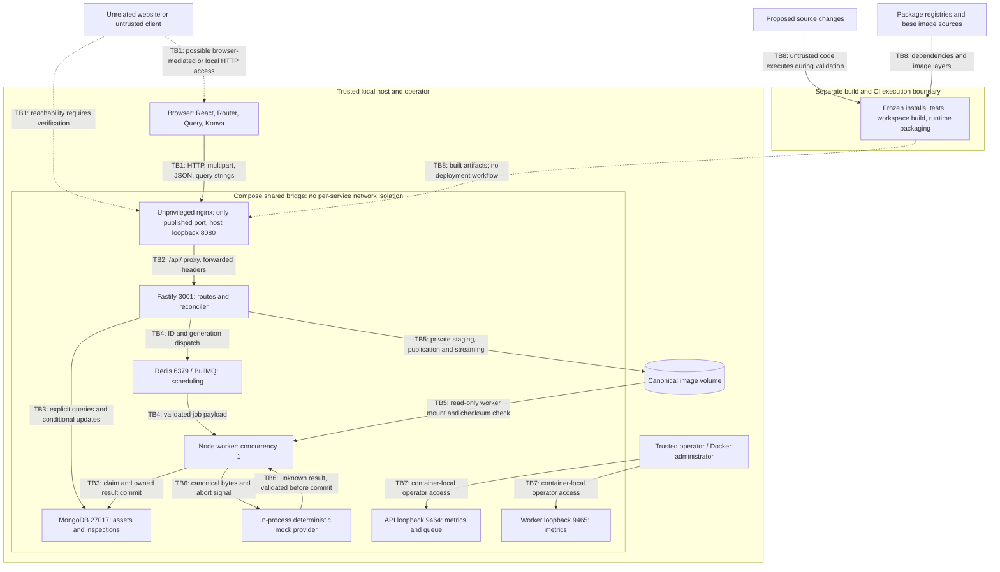

# Matroid security architecture and threat model

This model covers the implemented local application at the [SA-0 source baseline](sa-0-evidence.md). It separates verified source behavior from hypotheses requiring assessment. It does not assume a public, multi-user deployment.

## Deployment assumptions

- One trusted operator uses synthetic or authorized images on one host. Every client that reaches the API has the same application privileges. There are no accounts, sessions, ownership records, or tenant boundaries.
- Default full Compose publishes only web on `127.0.0.1:8080`. Native Vite and API bind to loopback; the optional development override publishes MongoDB/Redis on loopback. No port forwarding, tunnel, LAN binding, or public reverse proxy is assumed.
- The operator, Docker administrator, source checkout, environment configuration, database, and image storage are trusted. Untrusted local writers are outside the documented storage guarantee. A compromised browser page is still a relevant potential source of unwanted requests.
- The Compose default bridge is shared by all five services. It is not configured with `internal: true` or separate service networks. Unpublished ports restrict host ingress; they do not provide per-service isolation or an egress policy.
- MongoDB writes and the local filesystem remain authoritative and available under the existing reliability assumptions. At-least-once attempts, finite retries, and uncertain write acknowledgements remain supported behavior.

Sources: [README](../../README.md), [Compose](../../compose.yaml), [native override](../../compose.dev.yaml), [development](../development.md), [storage contract](../api.md), and [reliability](../reliability.md). Actual listeners, firewall rules, volume permissions, image identities, and overrides require later inspection.

## Protected assets and principals

| Asset | Security property and relevant data |
| --- | --- |
| Canonical images and asset records | Confidentiality when images are sensitive; byte/metadata integrity and availability; SHA-256, dimensions, source, storage key, and creation time |
| Inspections and original predictions | Accepted intent, correct lifecycle, bounded attempts, provider identity, detection boxes/confidences, and one authoritative committed result |
| Human reviews | Complete annotation snapshot, prediction references, revision, write sequence, and bounded operation receipts; protection against stale overwrites |
| Storage and queue capacity | Image/staging disk, MongoDB data/indexes, Redis memory/AOF, and bounded API/worker resources |
| Source and build artifacts | Dependency graph, executable code, CI workflow, runtime image contents, and artifact provenance |
| Operator information | Environment credentials if configured, local logs, correlation IDs, metrics, reports, and browser/test traces |

| Principal | Intended authority and limit |
| --- | --- |
| Local operator / API caller | Upload, read any asset/inspection/history, submit/retry, and review completed inspections; no per-user authorization boundary |
| Browser application | Same-origin HTTP client; validates responses and keeps unsaved drafts in memory; client validation is not server authorization |
| API process | Writes canonical images, assets, acceptance and review state; runs reconciliation; uses MongoDB and Redis without service-specific credentials in default Compose |
| Worker process | Reads the image volume, claims work, and commits execution state/results; MongoDB access is not restricted to those fields by database roles in default Compose |
| Inference provider | Receives bytes/metadata and an abort signal, returns unknown output; current adapter is an in-process deterministic mock with no external ML service |
| Host / Docker / database administrator | Can modify volumes, records, containers, and configuration; application immutability does not constrain privileged direct modification |
| Contributor / dependency / CI job | Proposed code and third-party packages can affect builds; CI executes checked-out code with `contents: read` workflow permissions |
| Unrelated website or compromised client | Untrusted HTTP initiator; browser network/origin restrictions must be verified before assuming loopback is sufficient protection |

`source=browser` or `source=api` is caller-supplied metadata, not identity. Object IDs, idempotency keys, review UUIDs, and cursors are not authorization credentials. The provider interface and separate worker package are code boundaries, not a sandbox for malicious provider code.

## Component trust boundaries

The operator listeners bind to `127.0.0.1` inside their respective containers, not the shared bridge interface, and nginx does not route them. Native execution enables them only through optional environment variables. Native mode replaces nginx with the Vite loopback proxy and uses host API/worker processes; its optional database host ports broaden local access. The worker health observation is a private file under `/tmp`, not an HTTP endpoint.

## Implemented data flow and controls

**HTTP and contracts.** [Fastify construction](../../apps/api/src/app.ts) disables AJV coercion and automatic removal of extra fields. [Shared schemas](../../packages/contracts/src/index.ts), [inspection schemas](../../packages/contracts/src/inspections.ts), [review semantics](../../packages/contracts/src/reviews.ts), and [history schemas](../../packages/contracts/src/history.ts) constrain known payloads. There is no authentication or authorization hook, configured CORS policy, Origin gate, or application rate-limit plugin in the inspected route setup. Unknown routes and application errors use a request-ID envelope; unexpected failures return a safe message. nginx-generated errors and errors after response streaming begins may differ from API JSON errors.

**Ingestion and files.** [Asset routes](../../apps/api/src/assets.ts) accept exactly one `image` file and optional bounded source field. Limits include 10 MiB input, 20 million decoded pixels, two active uploads per API instance, and bounded multipart parts/headers. [Image validation](../../apps/api/src/images.ts) inspects actual JPEG/PNG containers, rejects APNG/MPO/multiple frames, fully decodes, auto-orients, strips metadata, and re-encodes to sRGB. Encoding has a 10-second Sharp timeout; output is checked against 80 MiB after encoding. Startup bounds Sharp cache and concurrency. These controls do not establish a process-wide memory or disk quota.

[Storage](../../packages/backend/src/storage.ts) uses private staging, exclusive input creation, UUID filenames, a strict storage-key pattern, and atomic hard-link publication without overwrite. Client filenames and MIME declarations do not choose a path or accepted format. Asset responses omit internal paths/keys. Retrieval validates record shape and file type/length, then streams canonical bytes with `nosniff`, checksum ETag, and a one-year public immutable cache policy. Retrieval does not recompute the hash; the worker does. Storage ownership is an explicit trust assumption, especially for symlink/replacement races and same-length tampering.

**Persistence and review integrity.** [Asset and connection code](../../packages/backend/src/database.ts) and the [inspection model](../../packages/backend/src/inspection-model.ts) define two collections, unique storage keys, a unique scoped request-key index, and history/recovery indexes. Queries reconstruct filters from validated primitives rather than forwarding arbitrary client query objects. Mongoose buffering is disabled and connection/query time bounds are configured at selected boundaries; schemas are application models, not database-enforced access roles. [Review saves](../../packages/backend/src/reviews.ts) permit only completed inspections, validate prediction coverage and finite normalized boxes, allowlist review writes, match revision plus write sequence atomically, and retain 32 receipts. Original predictions are preserved through application write paths; the current review is not an immutable audit history.

**Queue and execution integrity.** [Acceptance](../../packages/backend/src/acceptance.ts) persists intent before 202 and fingerprints semantic requests in separate global create/retry scopes. [Reconciliation](../../packages/backend/src/reconciliation.ts) coalesces bounded hints and scans batches of 50 every five seconds. [Queue policy](../../packages/backend/src/queue.ts) bounds retained deliveries and applies backoff. [Execution](../../packages/backend/src/execution.ts) validates jobs, claims only matching due queued generations, uses attempt tokens and a 30-second lease, enforces a persistent three-attempt budget, checks image checksum, and validates/copies provider results. The 10-second attempt deadline is cooperative. Conditional commits exclude stale owners and previously committed results. Redis delivery is not proof of business completion and repeated inference is permitted.

**Containers and operations.** The [Dockerfile](../../infra/docker/Dockerfile) sets Node runtimes to `USER node`, prepares a mode-0700 image root, filters production dependency closures, and uses digest-pinned Node/nginx base images. The web target inherits the unprivileged nginx image. Compose mounts worker images read-only; API and worker use the same UID. MongoDB/Redis use version tags and have no credentials configured by default. The shared bridge and shared database identity mean application separation does not enforce database least privilege. No application service mounts a Docker socket or requests privileged mode. Normal services do not configure read-only root filesystems, dropped capabilities, or CPU/memory limits; Redis alone has an internal 256 MiB/noeviction policy.

**Supply chain and secrets.** [CI](../../.github/workflows/ci.yml) uses push/pull-request events, `contents: read`, job timeouts, frozen installs, Linux/Windows validation, real integration/browser tests, and disposable container recovery tests. It has no deployment/publishing step or explicit repository-secret expressions. Actions use version tags rather than commit SHAs. The root manifests pin Node 24.22.0/pnpm 10.34.7 and exact direct dependency versions; the lockfile records integrity metadata. Install builds are allowlisted for esbuild/Sharp. Ignore rules exclude local env/data/tooling from Git and Docker context. These controls do not prove the absence of secrets or dependency advisories, nor establish hosted repository settings.

## Attack surface inventory

All API paths below begin with `/api/v1`. No endpoint applies caller-specific access control in the supported local model.

| Entry point | Input and effect | Controls and assessment focus |
| --- | --- | --- |
| `POST /assets` | Multipart bytes, filename, MIME, source; creates image and metadata | Actual format/decode checks, sizes, slots, private staging; cross-origin initiation, malformed streams, multipart limits and cleanup |
| `GET /assets/:id` | Object ID; returns metadata | 24-hex ID and response validation; safe errors, no internal path disclosure |
| `GET /assets/:id/content` | Object ID; returns stored image | Key syntax, regular-file/size check, typed stream and `nosniff`; caching, aborted streams, same-length changes under storage trust assumptions |
| `POST /inspections` | JSON asset/provider plus required `Idempotency-Key`; durable intent | Fixed mock configuration, bounded ASCII key, fingerprint and unique index; admission growth, injected fields, concurrent conflict/replay |
| `GET /inspections` | `status`, string `limit`, base64url cursor; all-record history | Default 20/max 50, cursor validation, projection and query deadline; duplicate/operator query input, no privacy boundary in cursor |
| `GET /inspections/:id` | Object ID; lifecycle/result/review and optional latest retry | Public projection/contract validation; accidental internal-field exposure or corrupt-record errors |
| `PUT /inspections/:id/review` | Versioned snapshot, UUID, expected tokens | Max 200 annotations, taxonomy/coverage/box semantics, CAS and receipts; mass assignment, concurrent saves, stale replay |
| `POST /inspections/:id/retry` | ID, required key, absent/empty body; linked child | Failed-state eligibility and fingerprinted identity; stale state, key conflicts, repeated intentional children |
| `GET /health`, `GET /ready` | Liveness and dependency observations | Health rejects query fields; readiness checks DB and performs a storage staging/link probe; repeated readiness requests consume resources |
| SPA `/`, `/inspections`, `/inspections/:id`, `/health` | Route/query text and API responses; image/canvas rendering | React text rendering, validated relative content URLs, no raw HTML sink found in bounded source search; framing, cache behavior, browser-origin behavior |
| nginx `/healthz`, `/assets/`, `/api/`, SPA fallback | Host, path, headers and body | 11 MiB proxy body cap, fixed API upstream, timeouts; error format, forwarding and path normalization |
| Operator `/metrics`, API-only `/queue` | Exact GET paths on process-local loopback | No nginx/public registration, bounded sampling and labels; actual bind/publication and diagnostic leakage |
| Redis queue and MongoDB | Jobs, persisted assets/inspections, recovery metadata | Schema/semantic checks and conditional writes; invalid jobs, corrupted records, service compromise blast radius |
| Image root, heartbeat, maintenance CLI | Operator-configured paths, local entries, report/apply mode | Maintenance age/type/link/DB/exclusivity checks and report-only published orphans; OS-specific paths and race assumptions |
| CI/build/install graph | Contributor code, packages, actions, image tags/layers | Frozen graph, restricted workflow permissions, production closures; advisory applicability, install scripts, build artifacts and token handling |

Fastify may supply implicit HEAD behavior for GET routes. Methods, parser defaults, HTTP header limits, proxy normalization, and browser restrictions need verification against the pinned runtime, rather than assumptions from schemas alone. No URL-fetch inference endpoint, arbitrary provider selection, result-edit endpoint, WebSocket, authentication endpoint, or application deletion endpoint was found in the inspected runtime routes.

## Threats and prioritized review targets

Status terminology: **confirmed vulnerability** requires reproducible violation of an intended boundary and evidence of impact; **suspected weakness** is a plausible source-supported gap with exploitation unverified; **verification target** challenges an existing control without presuming a defect; **production opportunity** depends on a changed deployment model. No confirmed vulnerability is recorded in SA-0. Priorities indicate review order; severity is assigned only after validation in context.

| ID / priority | Status and realistic abuse case | Existing controls and decisive SA-1 evidence |
| --- | --- | --- |
| RT-01 / first | Suspected weakness: an unrelated page might initiate unwanted uploads or other requests to a running local demo, or frame its UI | Loopback and browser restrictions limit reachability; JSON/custom headers complicate some cross-origin requests, while multipart has a different path. No explicit Origin/Host gate or framing policy in inspected config. Test real browsers, two origins, simple multipart, preflighted JSON/PUT, Host handling and framing; distinguish read access from write effects. No DNS rebinding exploit is established |
| RT-02 / first | Suspected weakness: valid repeated requests, slow bodies, expensive images, full-size previews or new idempotency keys might consume disk/memory/queue capacity | Input/pixel/slot/cache/deadline bounds, bounded history/reconciliation and Redis noeviction exist; no total image/inspection retention quota or global admission policy is configured. Measure bounded occupancy and cleanup in isolation, without exhaustion tests; verify proxy/API limits and timeout interactions |
| RT-03 / next | Verification target: malformed IDs, query operators, unknown JSON fields or forged review metadata alter unintended data | Strict schemas, primitive filters and allowlisted updates exist. Trace and test rejection before side effects; snapshot original result/lifecycle/review before and after |
| RT-04 / next | Verification target: filenames, container ambiguity, partial uploads or malformed images escape storage, preserve active content, or leak private metadata | Canonical decode/re-encode, UUID key pattern, private staging and current tests exist. Extend bounded malformed fixtures and path cases; verify metadata stripping and failure cleanup. Local symlink writers are a separate assumption, not an established remote traversal |
| RT-05 / next | Verification target: replayed/stale jobs or concurrent saves replace predictions, roll back reviews or reset attempts | Tokens/generations/leases, indexes, CAS/write sequence and bounded receipts exist. Run and extend deterministic integration barriers; preserve uncertain-acknowledgement semantics and retry lineage |
| RT-06 / next | Verification target: logs, public projections, streams or caches expose paths, credentials, review internals or operational identifiers | Safe public failure messages, explicit DTOs, frontend error mapping, internal operator listeners and bounded metric labels exist. Inspect parser/proxy errors and access logs with synthetic markers. Assess public image caching against intended data sensitivity |
| RT-07 / next | Verification target: vulnerable dependency, mutable action/tag, build script or PR code compromises validation/artifacts | Exact versions, lock integrity, digest-pinned application bases, frozen installs and read-only workflow permission exist. Establish advisory applicability, artifact contents, action trust and hosted settings; no advisory or leaked credential is asserted |
| RT-08 / later | Production opportunity / manual verification: compromised web/API/worker accesses unauthenticated DB/Redis, writable files or outbound network; public exposure removes the local access boundary | Host loopback publication, non-root application runtimes, worker read-only image mount, process-local operator listeners. Verify actual topology/UID/mounts without writes. Authentication, per-service roles, network separation, egress controls and public TLS require a separately approved deployment design |

Review receipts and correlation logs support diagnosis but do not provide actor attribution or an immutable audit trail. Secret handling, backups, retention, and privacy requirements for real customer images remain open decisions. [Milestones and acceptance criteria](sa-0-plan.md) explain how targets become confirmed findings, accepted design limits, or closed hypotheses.
