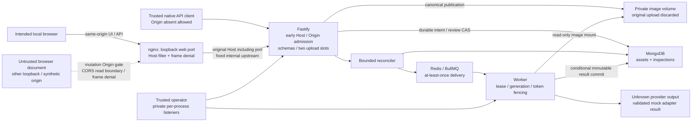

# Final threat model and trust boundaries

The supported system is a trusted single-user local demo with synthetic images and deterministic simulated inference. The same user/operator controls the host, native clients and persistent volumes. An unrelated browser document is untrusted even when another loopback origin serves it. An arbitrary native process can omit/spoof Origin and Host; no identity or tenant authorization is provided. Public or confidential-image deployment is a separate design decision.

## Assets, inputs and boundaries

| Asset / principal boundary | Untrusted input or realistic abuse | Existing/accepted final control | Remaining assumption |
| --- | --- | --- | --- |
| Browser context → local HTTP service | Unrelated-origin multipart, preflight, arbitrary Host, framing | SA-2 early Origin/Host policy; nginx preserves host port, CSP/XFO deny framing; no wildcard CORS | Only tested Chromium behavior and specified origins; native forgery and absent-Origin clients intentionally allowed |
| Upload bytes → canonical storage | Misleading MIME/name, malformed/multi-frame/pixel-heavy image, interrupted stream | Actual JPEG/PNG/container checks, inclusive 10 MiB/20 MP bounds, metadata stripping/auto-orientation, private staging, exclusive publication, one/two slots | No worst-case OOM/disk exhaustion claim; local filesystem/hard-link assumptions |
| Retained images/metadata → HTTP | Cache persistence, query canaries, filesystem paths/internal fields | Private no-store content, ETag/MIME/length, safe DTOs, template-based API logs and query-free normal nginx access logs | No authenticated image confidentiality or historical-cache/log purge; paths/IDs may still be diagnostic data |
| HTTP inputs → MongoDB | Operator-shaped filters, forged result/confidence/state fields, unbounded history | Explicit schemas/queries/projections, finite boxes, bounded history/cursors | No per-user/tenant boundary; local DB/wire access trusted |
| MongoDB intent → Redis/worker | Redis outage, duplicate delivery, stale attempt, lost acknowledgement | MongoDB-first 202, unique semantic idempotency, periodic recovery, finite persistent attempts and fenced result commit | Eventual dependencies/disk survive; clocks/leases assumed; execution can repeat |
| Human edit → review/result | Conflicting saves, replay, rollback, original prediction mutation | Revision + write-sequence CAS, bounded receipts, separate review snapshot; immutable original result | Current review plus bounded receipts, not an immutable full audit history |
| Package/runtime supply chain → executing process | Advisory-matched libraries, bundled unused tooling, mutable upstream references | Exact direct deps/lockfile, Node/nginx digests, verified Action commits, non-root runtime, no npm/npx final filesystem | Mongo/Redis tags unchanged; incomplete native/bundled applicability remains blocked |
| Test harness → host resources | Wrong volume/project cleanup; anonymous configdb orphan | SA-3 names/labels configdb; exact per-service mount/permission and resource ownership guards | Old unowned volume remains excluded; built-in bridge ID drift has no established cause |

Protected data includes canonical bytes/checksums, asset metadata, accepted inspection intent, original predictions, review revisions/receipts, queue ownership/attempt state, configuration, local logs and build/source provenance. Source metadata such as upload `source` is caller-supplied, not identity. MongoDB, Redis and image volumes are application-internal on the local host; the worker's image mount is read-only. Private operators remain container/process loopback listeners and are not nginx routes.

## Existing versus newly implemented controls

Canonicalization, query/contract validation, durable idempotency, worker fencing/recovery, result immutability, review concurrency, history pagination, health checks, non-root application users and private operators predate the security hardening increment. SA-2 added the explicit browser admission/framing policy, safer image cache/log defaults, configurable downward upload admission, immutable Action references/checkout handling and unused runtime npm removal. SA-3 changes **only audit-resource ownership and verification**, with deterministic and real down/up cleanup evidence; application/security behavior is frozen.

Resource threats remain bounded per request/concurrency, not cumulative retention. Uncertain MongoDB acknowledgements intentionally retain published images rather than risk deleting referenced data. No new automatic deletion, TTL, ledger, schema migration, authentication, tenancy, cloud service, provider sandbox or network rewrite was introduced. Unknown provider outputs are validated structurally/semantically; real ML, hosted-model and prompt-injection assessments were not performed.

Manual work still required includes complete vendor/native SBOM reconciliation, public deployment design, other browser/DNS scenarios, full filtered-history/hosted setting review, host-level operational investigation if desired and capacity/retention ownership. [Final register](findings.json) keeps these separate from the controls verified by the executed tests.
